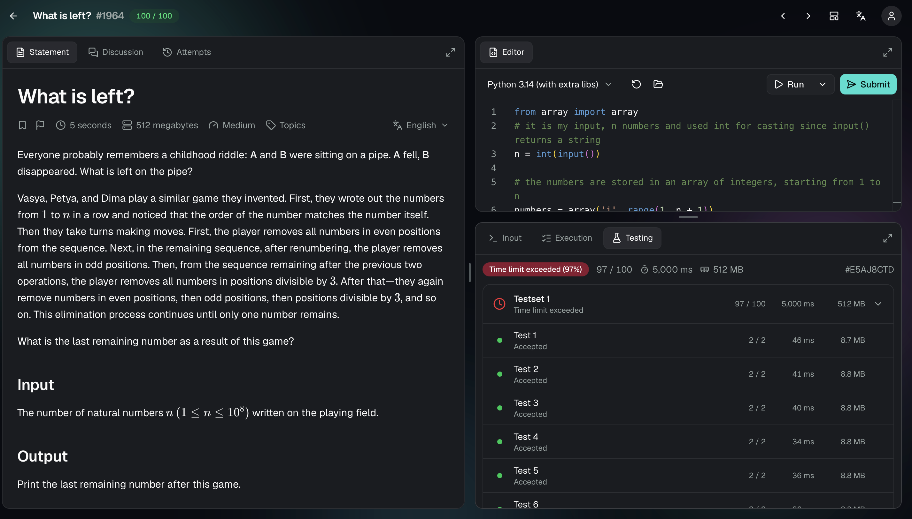
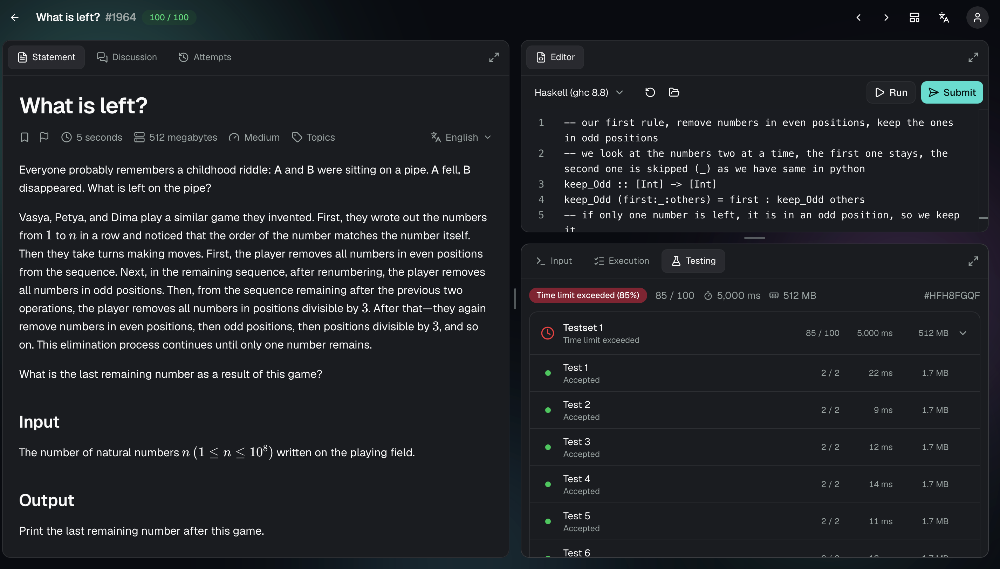

## Solution to e-Olymp problem:  What is left? 

(https://www.eolymp.com/en/problems/1964)

| Paradigm   | Language | File                                   | Score |
|------------|----------|----------------------------------------|-------|
| Imperative | Python   | [Python/main.py](Python/main.py)       | 97%   |
| Functional | Haskell  | [Haskell/main.hs](Haskell/main.hs)     | 85%   |

## How I solved it

The numbers `1..n` are processed round by round with three rules in a cycle: remove even positions, remove odd positions, remove positions divisible by 3. This repeats until one number is left.

**Python (imperative):** The numbers are stored in an `array('i')`. A `while` loop applies one rule each round using slicing: `[0::2]` keeps odd positions, `[1::2]` keeps even positions and `del numbers[2::3]` removes every third. A rule counter cycles with `% 3`.

**Haskell (functional):** There are no variables or loops. Each rule is a recursive function that uses pattern matching (`keep_Odd`, `keep_Even`, `drop_Third`), looking at 2 or 3 elements at a time and skipping the removed one with `_`. The `solve` function calls itself with the next rule until the list has one element.

## Results

**Python – 97%**

**Haskell – 85%**

